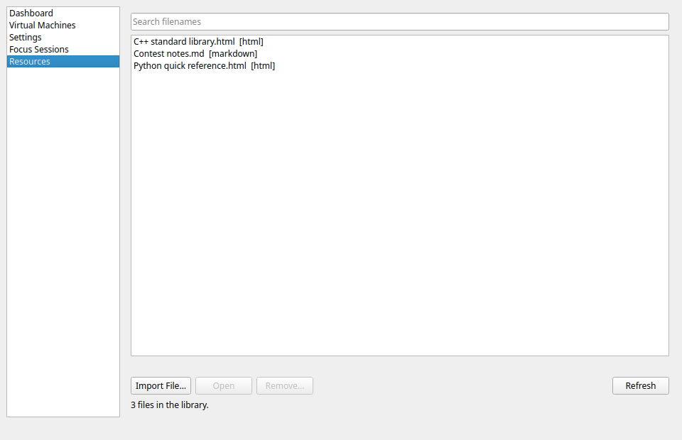

# FocusVM

FocusVM is a Linux project for practicing independent programming. Its development VM is designed to keep a terminal, tools, and local references close at hand so that reaching for AI assistance or switching tasks takes a deliberate step. You can leave a focus session at any time.

The PySide6 manager and CLI share settings and manage the same QEMU/KVM VMs through libvirt. The Fedora guest includes Vim, Git, C++, Python, debugging tools, and offline references. Deep Work, Contest, and Research sessions can open it fullscreen.

## Host compatibility

Use an x86-64 Linux host with Python 3.12 or newer, hardware virtualization, an authorized `qemu:///system` connection, and an active directory-backed storage pool. The desktop manager uses PySide6. Fullscreen sessions use virt-viewer and local SPICE. [Host prerequisites and troubleshooting](docs/setup.md#reference-hosts)

The VM and viewer recovery flow passed on Fedora 44 KDE Plasma on Wayland and on Fedora 44 GNOME Shell using a virtual Wayland monitor. A full Fedora Workstation login and physical shortcut checks are pending. Other Linux hosts with the same dependencies are compatibility candidates. [Verification record](docs/verification.md#phase-8-development-checks)

## Install and check the host

After installing the host prerequisites and preparing the storage pool, run these commands from the repository root. Use the system interpreter so FocusVM can load the distribution's libvirt binding.

```sh
python3 -m venv --system-site-packages .venv-vm
. .venv-vm/bin/activate
python -m pip install .
focusvm init --storage-pool focusvm
focusvm config validate
focusvm doctor
```

`init` records the storage pool name. Replace `focusvm` with the name of your active pool. The `doctor` command checks the host and reports missing prerequisites. To create a VM, supply a QCOW2 image, its signed manifest, and a trusted publisher keyring through the manager or `focusvm create`. [VM creation commands](docs/setup.md#phase-2-cli-workflow) · [Build and sign a guest image](docs/guest.md)

## Desktop manager

Install the optional Qt dependencies and launch the manager from your Linux desktop session.

```sh
python -m pip install '.[gui]'
focusvm gui
```

On first launch without settings, the wizard checks the selected storage pool and host dependencies before saving. Use **Virtual Machines** to create, start, inspect, or shut down a guest. [Desktop setup and usage](docs/setup.md#desktop-manager)



## Start a focus session

Select your VM in the desktop manager, then open **Focus Sessions** and choose **Start Focus Session**. From a host terminal you can also run the following commands.

```sh
focusvm session start --profile deep-work
focusvm session status
focusvm session end
```

**Shift+F12** releases input and **Shift+F11** toggles fullscreen. Ending the session closes its viewer and leaves the offline guest running. [Focus sessions and recovery](docs/sessions.md#start-end-and-recover)

Strict and Balanced guests start without a network interface. Wayland users can optionally run the viewer inside Cage. Use the manager, the Cage host window, or `focusvm session end` from another host terminal to exit Cage. [Networking and viewer behavior](docs/sessions.md) · [Optional Cage viewer](docs/advanced-sessions.md#optional-cage-viewer)

## Offline references and synchronization

Import PDF, HTML, Markdown, and ZIM files in the manager’s **Resources** page. The CLI can attach a read-only reference disc, transfer Git bundles, and explicitly fetch or push from the host outside a focus session. WakaTime records activity only when you opt in and supply events. [Offline resources and synchronization](docs/resources-and-sync.md)

Use Contest for an optional timer or Research for a session with local references. The CLI can save approved web references before a session, attach offline Python wheels, and record journal entries with optional statistics. [Advanced sessions and maintenance](docs/advanced-sessions.md)

## Development and release

- [Architecture and configuration](docs/architecture.md)
- [Development and contribution guide](CONTRIBUTING.md)
- [Security policy](SECURITY.md)
- [Release notes](CHANGELOG.md) and [release procedure](docs/release.md)
- [MIT license](LICENSE) and [third-party notices](NOTICE)

This project is partially AI-generated.
